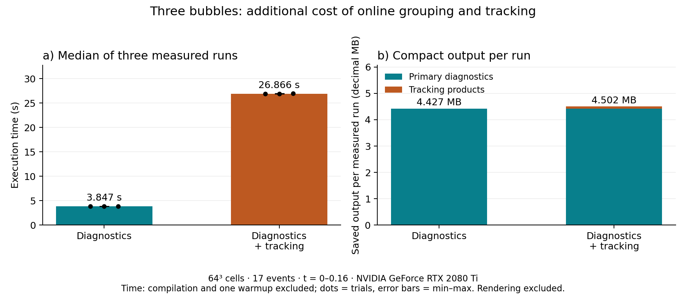

# Complete online tracking workflow: GPU benchmark

## Result

The copied benchmark passed local product revalidation. For the tested three-bubble
64-cubed case, adding grouping/tracking increased median execution
from 3.847 s to 26.866 s:
**23.020 s added, 598.5% overhead,
6.98 times the baseline duration**.
This is a substantial cost; a favorable performance ratio is not a correctness requirement.

| Measurement | Diagnostics | Diagnostics + tracking |
| --- | ---: | ---: |
| Median execution (s) | 3.846545 | 26.866302 |
| Minimum–maximum execution (s) | 3.835317–3.853050 | 26.853911–26.929483 |
| Compilation, excluded (s) | 49.454 | 49.966 |
| Primary output per run (bytes) | 4426589 | 4426589 |
| Additional tracking output (bytes) | 0 | 75534 |
| Total output per run (decimal MB) | 4.426589 | 4.502123 |
| Sampled whole-worker GPU peak (MiB) | 454.0 | 454.0 |
| Whole-worker peak host RSS (decimal GB) | 1.524068 | 1.528046 |



## What was measured

Actual execution: compgpu6, CUDA_VISIBLE_DEVICES=0,
NVIDIA GeForce RTX 2080 Ti, Python 3.12.16, JAX 0.6.2, NumPy 2.2.6.
Both modes used 17 analysis events through t = 0.16, identical three-source budgets,
and the same event-related timestep boundaries. Each mode compiled once, performed
one excluded warmup, and ran 3 measured repetitions in its own process.

Diagnostics already includes shock finding, data transfer, histories, histograms,
sparse surface catalogs and background slices. Tracked mode adds spatial grouping,
temporal associations, both delayed-support variants, group statistics and tracking
exports. The increment measures this complete implemented package, including its
comparison-oriented support variants; it is not an isolated association-kernel time.
Neither mode writes a complete gas-state sequence. Animation rendering is excluded.

Most of the added time occurs inside synchronized integration and callbacks;
the measurements do not isolate individual tracking operations or establish a
specific bottleneck. Measured output sizes are identical across the three trials
within each mode. Tracking adds 75.534 kB per run
(1.71% of primary output).
Logs, benchmark reports, memory-sample tables and deleted warmup output are excluded.

## Verification and interpretation

All 3 pairs of primary diagnostic products match using the original exact/tolerant
rules. Tracked repetitions reproduce one another, and the first tracked trial agrees
with batch assembly over 17 events
(32 adjacent and
64 delayed results). Every warmup
and measured trial records the same final-state hash and 660 solver iterations.
Tracked group-observation counts are [45, 45, 45].
Final-state hashes were checked
remotely; full final gas arrays were not copied and are not independently rehashed here.
These are consistency checks, not independent physical ancestry labels.

The local audit rechecks copied products, worker/controller records, summary arithmetic,
phase sums, output bytes, memory samples, the source-budget reference and all recorded
code fingerprints. It does not rerun hydrodynamics or GPU timing.

The broken GPU 2 generated repeated monitor warnings although the simulation used
GPU 0. The saved monitor records contain 246 diagnostics
samples and 529 tracked samples, with zero recorded query
exceptions. Both peaks recompute to 454 MiB. Query exceptions do not account for
all device warnings. These are sampled exact-worker-PID allocations, not complete
GPU health measurements or guaranteed true peaks. Host RSS includes imports,
compilation and warmup; the small difference is not a tracker-only memory measurement.

The workflows ran sequentially in fixed order on a shared machine; file writes
were not synchronized to physical storage. This single resolution/cadence does
not establish general scaling. The RTX 2080 Ti results must not be compared directly
with earlier H100 timings as an algorithm-speed comparison.

## Checkpoint

Step 3's measurement and interpretation are complete for this configuration.
The implemented workflow is consistent with its references, compact on disk,
and substantially slower when the complete grouping/tracking package is enabled.
Freeze this evidence for the thesis; no additional simulation or algorithm change
is required to complete this bounded benchmark step.

Reproduce the copy check and figure from the repository root:

```sh
python -m experiments.wind_bubble.summarize_tracking_benchmark outputs/tracking_benchmark_iwr_compgpu6_gpu0_n064
```
